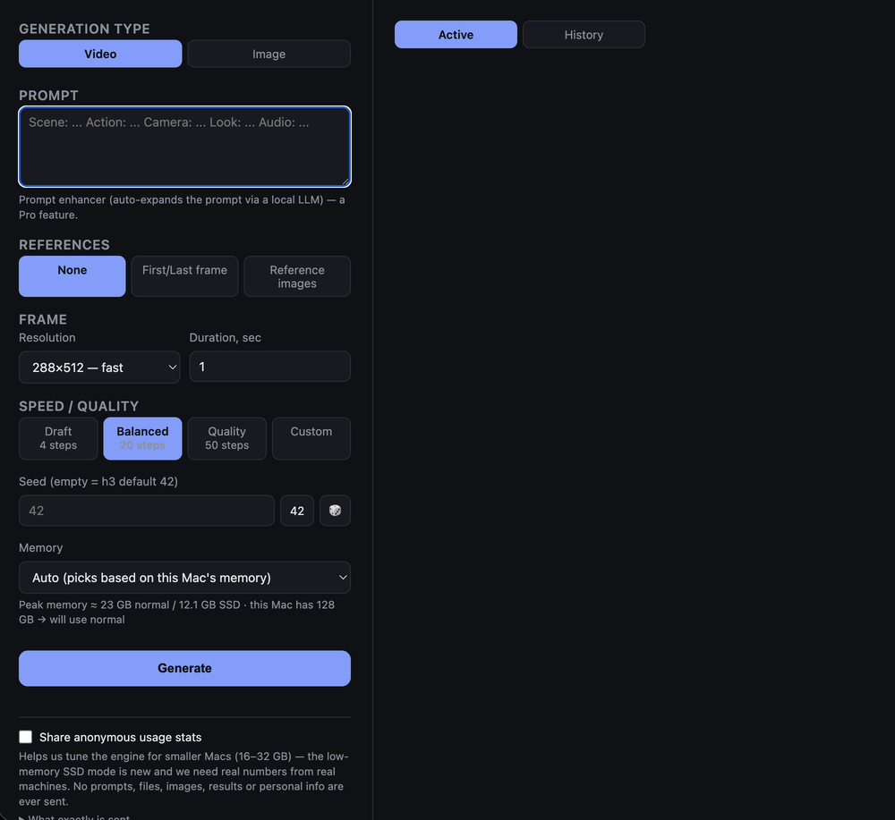

# MiniMax H3 — Lite

A free Mac app for [MiniMax H3](https://huggingface.co/MiniMaxAI/MiniMax-H3) (built on [antirez/h3.c](https://github.com/antirez/h3.c)): one-click setup and model download, then a simple local UI in your browser for text-to-video and text-to-image. No ComfyUI, no cloud, no API keys — everything runs on your own Apple Silicon Mac.

 

## What it does

- Text-to-video and text-to-image generation with h3.c, through a simple web UI (opens in your browser, served locally).
- Speed/quality presets (Draft 8 steps / Balanced 20 / Quality 50) plus a Custom mode for manual `steps` / `layers` / `reuse`.
- Reference modes: first/last-frame anchoring, or up to 3 reference images.
- **Memory modes for smaller Macs** — Normal, Low-memory SSD, or Auto (see below).
- An Active / History view — history survives server and browser restarts: it's rebuilt from what's already in `outputs/` and `server/jobs/`, so nothing generated is lost between sessions.
- A one-click `.app` launcher — no terminal required for day-to-day use.

## Requirements

- An Apple Silicon Mac (M-series). This is not going to work on Intel Macs or non-Apple hardware.
- **~210 GB of free disk space** for the model weights (see "First run" below) — no partial-download option, plan accordingly.
- A free [Hugging Face](https://huggingface.co) account, to accept the model's license and generate a read token.
- Xcode Command Line Tools (only needed to build the engine on first run; the launcher will prompt you to install them if missing).
- An internet connection for the one-time setup (cloning/building the engine, downloading weights). Generation itself is fully offline afterward.

## Quick start

1. `git clone` this repository (or download it as a ZIP and unzip it).
2. Double-click `Launch MiniMax H3 Lite.app`.

The app isn't code-signed, so macOS will refuse to open it the first time ("Apple could not verify..."). Right-click (or Control-click) it and choose **Open** instead of double-clicking — that shows an "Open Anyway" option double-click doesn't. You only need to do this once.

That's it for day-to-day use. **First run is different** — see below.

### First run

On a fresh clone, the launcher has nothing to work with yet: no `h3.c` engine, no compiled binary, no model weights. The first double-click walks you through all of it with a few plain dialog boxes (a visible Terminal window stays open in the background so you can see it isn't just hanging):

1. Clones and builds `h3.c` (a minute or two).
2. Opens the Hugging Face pages for the model license and your access token, then asks you to paste the token in.
3. Downloads the model weights (~210 GB — this is the slow part, easily hours depending on your connection).

Once that's done, the server starts and your browser opens automatically. Every run after that is instant — the launcher just checks whether the server's already up and opens the browser, or starts it in the background if not.

## Smaller Macs: memory modes

Next to the Generate button there's a **Memory** setting:

- **Normal** — fastest. The whole transformer stays in memory.
- **Low-memory SSD** — the engine streams the transformer weights from your SSD two blocks at a time (`--ssd-streaming`, built into h3.c). Peak memory roughly halves; generation is 1.1–1.5× slower (the gap shrinks on longer, larger clips).
- **Auto** (default) — estimates the peak for your resolution and length and picks Normal if it fits in this Mac's memory (with ~8 GB left for macOS), otherwise SSD. The hint under the setting shows the estimate, and the job card shows "💾 SSD" when it was used.

Measured peak memory on an M5 Max (benchmark runs within the engine's 4–15 s range):

| Clip | Normal | Low-memory SSD |
|---|---|---|
| 576×1024, 5 s | ~20 GB | ~11 GB |
| 768×1344, 5 s | ~23 GB | ~12 GB |
| 576×1024, 15 s | ~27 GB | ~14 GB |

Rough guide: 48 GB+ Macs can run Normal for almost everything; 32 GB runs Normal for short clips and SSD for longer or larger ones; 24 GB needs SSD; 16 GB is a tight squeeze even with SSD (short clips, expect some swapping).

These numbers come from one big machine. **Real 16–32 GB Macs are exactly what we can't test ourselves** — that's what the anonymous stats below are for.

## Anonymous usage stats

The app can send one small anonymous record per finished generation so we can see how the engine behaves on hardware we don't own and tune the memory modes for smaller Macs. It's on by default and can be switched off at any time with the **Share anonymous usage stats** checkbox in the sidebar (or by starting the server with `H3_TELEMETRY=0`).

**Never sent:** prompts, images, videos, file names or paths, generation results, your name, email, or anything that identifies you.

**Sent** (and nothing else — see `server/telemetry_client.py`):

- app edition and version; a random install ID created on first run (not linked to you or your Apple ID)
- Mac model, chip, macOS version
- total RAM, free RAM at the start of the generation, peak memory used by the engine, memory pressure during the run (page-outs)
- resolution, length in seconds/frames, steps / layers / reuse / preset, memory mode (Normal or SSD)
- how many reference images were used (just the count) and whether a first/last frame was used
- how long it took, and whether it succeeded (an exit code if not)

## Lite vs. Pro

This is the free, source-available edition. A couple of things are intentionally limited compared to the Pro version:

- Reference images: up to 3 per generation (Pro: up to 9).
- No prompt-enhancer (an LLM-assisted prompt expansion feature, Pro-only).

Everything else — presets, both generation modes, the first/last-frame anchor mode, history — is the same engine and the same UI.

## About the model license

MiniMax H3's weights are distributed separately under the
[MiniMax H3 Community License Agreement](https://huggingface.co/MiniMaxAI/MiniMax-H3/blob/main/LICENSE),
not by this repository. That license currently excludes use within the
US, EU, UK, and South Korea without separate authorization from MiniMax.
This tool does not host or distribute the weights — you download them
yourself, in your own name, and accept MiniMax's license directly during
the first-run setup. It is your responsibility to confirm you're
permitted to do so under that license in your jurisdiction.

This project is not affiliated with Apple, MiniMax, or antirez.

## Troubleshooting

`RUN.md` has more detail on running from the terminal directly and on recovering a stuck generation (leftover `h3` process still holding the GPU after a crash or force-quit).

## License

Source-available — see [`LICENSE.md`](./LICENSE.md). In short: you can view, run, and modify your own copy for personal use; you may not redistribute, sell, or resell it. The model weights and the `h3.c` engine are not bundled here and remain under their own respective licenses (downloaded separately by the setup step above). See "About the model license" above for details on MiniMax H3's usage restrictions.

## Credits

- [antirez/h3.c](https://github.com/antirez/h3.c) — the inference engine this wraps.
- [MiniMaxAI/MiniMax-H3](https://huggingface.co/MiniMaxAI/MiniMax-H3) — the model weights.
